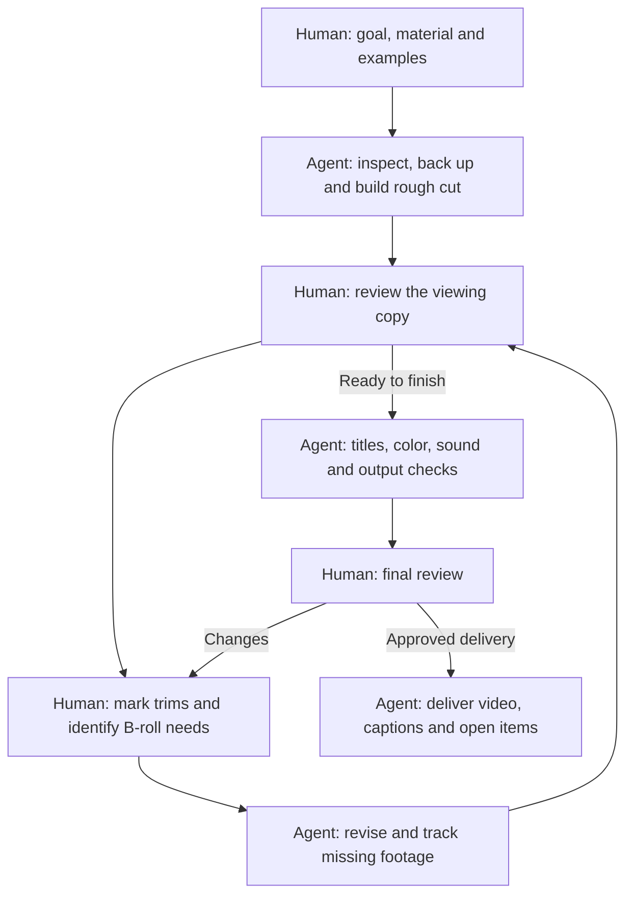

# DaVinci Workflow Skills

Reusable DaVinci Resolve skills for AI-assisted video editing. One skill per workflow step, shared by Codex and Claude Code. **Version 0.2.0 · MIT**

**Index:** [Review loop](#human-and-agent-review-loop) · [Skills](#skills) · [Prerequisites](#prerequisites) · [Install](#install) · [Prompts and sheets](#prompts-and-sheets) · [Testing](#testing) · [Contribute](#contribute)

## Human and agent review loop

The human decides what the video should say and whether the edit works. The agent protects the project, makes revisions and checks the files.

Read the [human review guide](docs/human-review-workflow.md) for what to supply, a simple trim table, precise B-roll requests, manual-edit preservation and final review. Reviews can be bundled; the agent carries forward choices and export authorization already given.

## Skills

| Step | Skill | Outcome |
| --- | --- | --- |
| Media | [davinci-media](skills/davinci-media/SKILL.md) | Inventory, milestones, bins and source-safe proxies |
| Edit | [davinci-edit](skills/davinci-edit/SKILL.md) | Script assembly, revisions, captions and manual-edit preservation |
| Edit: B-roll | [davinci-broll](skills/davinci-broll/SKILL.md) | Relevant coverage, continuity, variety and footage requests |
| Titles | [davinci-titles](skills/davinci-titles/SKILL.md) | Reference-led typography, name cards, style adaptation and glyph repair |
| Fusion | [davinci-fusion](skills/davinci-fusion/SKILL.md) | Editable node graphs, animation, alpha and verified composites |
| Color | [davinci-color](skills/davinci-color/SKILL.md) | Signal diagnosis, scopes, transforms and shot matching |
| Fairlight | [davinci-fairlight](skills/davinci-fairlight/SKILL.md) | External-audio sync, dialogue, music and peak checks |
| Export / Deliver | [davinci-export](skills/davinci-export/SKILL.md) | Smaller individual clips or verified final-film delivery |
| Dropbox | [dropbox-media-management](skills/dropbox-media-management/SKILL.md) | Bounded downloads, local proxies and online-only management |

Use a step directly or follow the [workflow contract](docs/workflow-contract.md). Skills include essential safeguards and work individually.

## Prerequisites

- Resolve running with the intended project open. The originating workflow used **DaVinci Resolve Studio 21.1.2**; features and scripting differ by version/edition.
- **Set up DaVinci AI Assistants: File > Setup AI Assistants...** Follow setup for your assistant, then verify a read-only project/timeline query. If this menu is absent, check your installed version and its integration instructions.
- A working Resolve tool connection for automation and computer-use access for unsupported controls. These skills do not install or bundle an MCP server. Third-party Resolve MCP servers are separate integrations with their own setup and capabilities.
- Accessible media, local disk headroom and a recoverable project backup. Dropbox desktop with the correct signed-in account is required for residency operations.
- FFmpeg/FFprobe when transcoding or file QC is needed. A licensed compatible LUT and its guide only when requested. No media, LUTs, fonts or credentials are included.

## Install

### Codex plugin

With a current Codex CLI:

~~~sh
codex plugin marketplace add amartinez1558/davinci-workflow-skills --ref v0.2.0
codex plugin add davinci-workflow@davinci-workflow-skills
~~~

Start a new chat/session. If your client uses a Plugins UI, add the cloned repo as a local marketplace and install **DaVinci Workflow**. The repo includes a portable manifest, Codex compatibility manifest and repository marketplace. See [official packaging](https://developers.openai.com/plugins/build/plugins).

### Claude Code plugin

~~~text
/plugin marketplace add amartinez1558/davinci-workflow-skills
/plugin install davinci-workflow@davinci-workflow-skills
~~~

Start a new session. For an exact version, clone the tag below, then use /plugin marketplace add /absolute/path/to/davinci-workflow-skills. See [Claude marketplace instructions](https://code.claude.com/docs/en/plugin-marketplaces).

### Clone or install individual skills

~~~sh
git clone --branch v0.2.0 --depth 1 https://github.com/amartinez1558/davinci-workflow-skills.git
~~~

Copy desired skill folders into your client's skill directory: current Codex uses ~/.agents/skills/ and Claude Code uses ~/.claude/skills/. Review before overwriting existing same-name skills. Keep the clone for prompts and templates. No install script changes your assistant settings.

Invoke in Codex with $davinci-broll. In Claude Code, use /davinci-broll for an individual skill or /davinci-workflow:davinci-broll for the plugin installation; replace the skill name for other stages.

## Prompts and sheets

- **Start here: [Beginner video prompt](prompts/beginner-intake.md)** — guided skills/Resolve setup, everyday questions and sensible defaults; no technical knowledge needed
- [Original clip-sharing request, organized](prompts/clip-sharing-example.md)
- [Documentary-edit example](prompts/documentary-example.md), using Jane Doe and John Doe
- [Advanced intake prompt](prompts/project-intake-template.md), for detailed project control
- [Script CSV](templates/video-script.csv) and [remaining-footage CSV](templates/remaining-footage.csv) for Google Sheets
- [Template field guide](docs/templates.md): time domains, multiple links and statuses

## Testing

**Author-reported: tested and used with GPT 6.1 Sol High.** This is the stated model/reasoning baseline for the originating editing work. These skills distill that workflow and feedback; this does not claim universal model support or a complete end-to-end retest of the packaged release.

[Validation](docs/validation.md) records release checks and limits. Claude runtime and other Resolve versions remain compatibility targets until separately exercised.

## Contribute

Follow [CONTRIBUTING.md](CONTRIBUTING.md). Each skill carries metadata.version; release manifests share a package version, with vMAJOR.MINOR.PATCH Git tags and a [changelog](CHANGELOG.md). Publish instructions and synthetic examples, without project media, real subjects' identities, private links, licensed assets or credentials.
